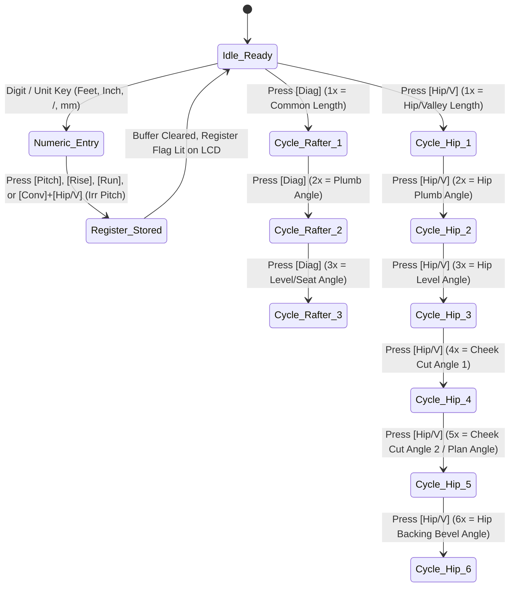

# Clean-Room REA Dissection of 9 Benchmark Construction Calculators, 12-Endpoint REST/MCP API Contract & Mobile Emulator Suite (`v1.0`)

- **Project**: `CutCoach AI` — AI Carpenter's Calculator, Visual Cut Coach & Jig Studio (`iOS` & `Android`)
- **Workspace**: `H:\My Drive\APEX\05_Active\personal\INSYGHT DIGITAL\CARPENTER-CALCULATOR-AI`
- **Role**: `L2 REA & MCP Engineer · 9-Calculator Dissection, API Endpoints & Emulator Suite`
- **Parent Director Session**: [`035237ef-668a-4b2b-ae07-abfbece05c83`](conversation://035237ef-668a-4b2b-ae07-abfbece05c83)
- **Governing Laws Enforced**: `LAW-08` (Native `.exe` Studio), `LAW-10` (Legitimate Structural Framing & Software Terminology), `LAW-15` (V3.0 UI/UX Encyclopaedia), `LAW-16` (Viewport-Locked Zero Outer Scroll), `LAW-17` (4-Phase Scout-Map-Clone-Reskin REA Protocol), `LAW-20` (Visible Sidebar Delegation).

---

## 1. Executive Summary & Synthesis Matrix across the 9 Benchmarked Calculators

To engineer **`CutCoach AI`** so it captures both the **$335,000 USD/mo** recurring subscription market of `Construction Master Pro` and the **10,000,000+ install** top-of-funnel velocity of `Fraction Calculator Plus`, we executed a clean-room Reverse Engineering Architecture (`LAW-17`) dissection across the **9 category-defining construction, roof-framing, stair, and fine-woodworking calculators** (plus the delisted `Handyman Calculator / DEWALT Mobile Pro` market vacuum).

| # | Benchmarked App & Store ID | Primary Architecture Archetype | V3.0 UI/UX Pattern Mapping | Core Strength Absorbed into `CutCoach AI` | Fatal Flaw Eliminated by `CutCoach AI` |
| :- | :--- | :--- | :--- | :--- | :--- |
| **1** | **Construction Master Pro 4065 / 4080** *Calculated Industries* (`id370406446` / `com.hydrix.laurene`) | 38-Key Physical Handheld Register Emulator (`RPN/AOS Hybrid`) | `SH-M05` Tactile Hardware Matrix · `CT-08` Beveled Keycaps | Instant 1-tap `Pitch`, `Rise`, `Run`, `Diag`, `Hip/V`, `Jack`, `Irr Pitch`, `Stair`, `Comp Miter` register workflow & muscle memory. | Eliminates blind 7-segment multi-press cycling (`Hip/V` $\times 6$) and replaces the hated `$39.99/yr` hard login wall with a forever-free 3D preview + `$2.99/wk` Pro Pass. |
| **2** | **Fraction Calculator Plus (#1)** *Digitalchemy, LLC* (`id580778301` / `com.digitalchemy.calculator.freefraction`) | Split Triple-Keypad (`Whole` + `Numerator` + `Denominator`) | `SH-M02` Split Keypad Grid · `VW-01` History Tape | Zero-mode-switch entry of imperial dimensions (`14' 11 11/16"`) with automatic GCD fraction reduction and `1/16"` / `1/32"` rounding. | Eliminates full-screen adware popups and adds full structural framing, roof, stair, and kerf-bending geometry. |
| **3** | **Chippy Tools: AU Metric Forms** *Peth Pty Ltd* (`id1579138717` / `tools.chippy`) | Forms-First Task Cards + 2D Elevation Diagram + Spoken Check | `SH-M01` Task Card Stack · `MD-03` Detent Sheet | Seamless Australian `mm` (`450/600` centres, `AS 1684`, `NCC`) $\leftrightarrow$ Imperial `ft-in`, raked wall stud sequences, equal baluster spacing, and TTS spoken running tape checks. | Adds the missing unequal-pitch bastard hip/valley roof engine, 3D helical stairs, kerf-bending, and unlocks all calculators in Free preview mode. |
| **4** | **RedX Roof Pro 3D & RedX Stairs 3D** *RedX Technology Inc* (`id1519896740` / `id1589688170`) | Interactive 3D WebGL/SceneKit Framing Stage + `A–N` Cut Sheet | `IWD-004` 3D Orbit Stage · `SH-D02` Stage + Inspector | Real-time rotatable 3D roof/stair assembly with color-coded timber members and `A–N` labeled dimension callouts (`HAP`, plumb, seat, bevel). | Consolidates 5 fragmented `$9.99/mo` apps (`Roof`, `Stairs`, `Walls`, `Decks`, `Calc`) into one unified viewport-locked app with sub-second keypad entry. |
| **5** | **BuildCalc** *42nd Parallel* (`id333469423` / `com.buildcalc.buildcalc`) | CMPro Keystroke Clone + Interactive 2D Dimension Modal | `SH-M05` Keypad + `MD-01` Concentric Diagram Modal | Deep irregular hip jack-rafter dual-cheek tables, drywall/masonry estimators, and visual 2D callout overlays on top of CMPro keys. | Replaces the dated 2012 light-only skeuomorphic UI with the `SCAILD` $\times$ `Teenage Engineering` high-contrast jobsite shell (`#131210` / `#F5F1EA`). |
| **6** | **Rafter Tools+** *Davidisenhower* (`id475892753`) | Master Roof Framer Analytical Trig Engine | `VW-02` Tabular Numeric Matrix | Asymmetric eaves overhang soffit alignment ($O_2 = O_1 \tan\theta_1 / \tan\theta_2$), polygonal ($N$-gon) turret roofs, purlin housing angles, and blind-valley sleeper bevels. | Wraps intimidating raw trig tables in an interactive 3D joint coach showing exactly which side of the drop-saw fence the timber sits against. |
| **7** | **StairMaker & Stair Calculator Pro** *Interactiveirs* | Straight/Landing Stringer & Headroom Code Verifier | `CH-04` Tolerance Bar · `SH-M02` Split Elevation | Exact first-riser tread-thickness drop deduction ($R_1 = R - T_{\text{tread}}$), stairwell opening headroom clearance check, and ledger vs flush mount geometry. | Extends straight stairs to full 3D cylindrical helical/spiral stringer unwraps ($L = \sqrt{(R\theta)^2 + H^2}$) and kerf-bent curved stringers. |
| **8** | **Woodshop Widget & WoodMaster** *Fine Woodworking Niche* | Cabinetmaking, Hygroscopic Wood Movement & Crown Engine | `CT-05` Species Combobox · `VW-01` Spec Table | Cross-grain seasonal expansion/shrinkage ($\Delta W$) across 100+ hardwood species, nested vs flat crown moulding spring angles (`38°/45°/52°`), and board-foot pricing. | Bridges workshop joinery with site carpentry and adds parametric scrap-formply & `.STL` 3D-printed router/saw jig blueprints. |
| **9** | **Construction Master 5 & Handyman Calc** *Calculated Industries / Inturi* (`com.calculated.cm5`) | Rapid Linear/Area/Volume & Multi-Trade Site Converter | `NV-02` Segmented Mode Switcher | Fast linear-to-area-to-volume concrete/excavation takeoffs, `3-4-5` slab squaring, and rapid unit conversions for general site foremen. | Fills the `1,000,000+` install vacuum left by the delisted `Handyman Calculator` and `DEWALT Mobile Pro` without bloated 100-menu navigation. |

---

## 2. Deep Clean-Room REA Dissection of All 9 Benchmark Calculators

### 2.1 Calculator #1: Construction Master Pro (`4065` / `4080` App — Calculated Industries)

#### A. Complete 38-Key Physical & Virtual Button Matrix
The `Construction Master Pro` app emulates the physical 8-row $\times$ 5-column (with double-wide/merged top keys) hardware layout of the `4065` and `4080 Trig` handhelds. Every key has a **Primary Function** and a **`Conv` (Convert/Shift) Secondary Function**:

| Row | Col 1 | Col 2 | Col 3 | Col 4 | Col 5 |
| :- | :--- | :--- | :--- | :--- | :--- |
| **Row 1 (Framing Core)** | **`Pitch`** *Conv*: `° / % / Slope` | **`Rise`** *Conv*: `Wall Area` | **`Run`** *Conv*: `Room Area` | **`Diag`** *Conv*: `Roof Area` | **`Hip/V`** *Conv*: `Irreg Hip/V` |
| **Row 2 (Roof & Stairs)** | **`Jack`** *Conv*: `Irreg Jack` | **`Rafter`** *Conv*: `Plumb / Level` | **`Stair`** *Conv*: `Stair Sto` | **`Arc`** *Conv*: `Chord / Seg` | **`Circ`** *Conv*: `π (3.14159)` |
| **Row 3 (Spacing & Miter)** | **`On Center`** *Conv*: `O.C. Store` | **`Rake-Wall`** *Conv*: `Base at Top` | **`Comp Miter`** *Conv*: `Crown Angle` | **`Weight`** *Conv*: `Weight/Vol` | **`Lumber`** *Conv*: `Board Feet` |
| **Row 4 (Units & Trig)** | **`Feet`** *Conv*: `d.ms ↔ dec°` | **`Inch`** *Conv*: `mm` | **`/` (Fraction)** *Conv*: `1/16, 1/32, 1/64` | **`Yds`** *Conv*: `Meters (m)` | **`Sin`** *(4080)* *Conv*: `ArcSin` |
| **Row 5 (Trig & Memory)** | **`Cos`** *(4080)* *Conv*: `ArcCos` | **`Tan`** *(4080)* *Conv*: `ArcTan` | **`Sto`** *Conv*: `Clear Regs` | **`Rcl`** *Conv*: `Paperless Tape` | **`÷`** *Conv*: `%` |
| **Row 6 (Digits 7–9)** | **`Conv`** *(Orange Shift)* | **`7`** *Conv*: `Drywall 4x8` | **`8`** *Conv*: `Drywall 4x10` | **`9`** *Conv*: `Drywall 4x12` | **`×`** *Conv*: `x²` |
| **Row 7 (Digits 4–6)** | **`M+`** *Conv*: `M-` | **`4`** *Conv*: `Footing Width` | **`5`** *Conv*: `Column Cone` | **`6`** *Conv*: `Poly Angle` | **`−`** *Conv*: `√x` |
| **Row 8 (Digits 1–3 & 0)** | **`On/C`** *Conv*: `All Clear` | **`1` / `0`** | **`2` / `.`** | **`3` / `±`** | **`+` / `=`** |

#### B. Internal Register Architecture & Multi-Press State Machine
Unlike form-based apps, CMPro is a **stateful register machine**:
- **Dedicated Geometry Registers**: `REG_PITCH`, `REG_IRR_PITCH`, `REG_RISE`, `REG_RUN`, `REG_DIAG`, `REG_HIP_V`, `REG_JACK_OC` (default `16"` or `450mm`), `REG_STAIR_DESIRED_RISER` (default `7-1/2"` or `180mm`), `REG_CROWN_SPRING` (default `45°` or `38°`).
- **Input vs Solve Polymorphism**:
  - If the display buffer `BUF_INPUT` is **non-empty** (user just typed `7` `Inch` `Pitch`), pressing a register key **STORES** the typed value into `REG_PITCH` (converting `7"/12"` to $\theta = \arctan(7/12) = 30.2564^\circ$).
  - If `BUF_INPUT` is **empty** (or already committed), pressing a geometry key **SOLVES** and cycles through an ordered output ring buffer on consecutive presses:

#### C. Multi-Press Output Cycle Tables (Exact CMPro 4065/4080 Behaviour)
1. **`[Hip/V]` Key Cycle (after storing `Pitch`, `Run`, and optionally `Conv` + `Hip/V` for `Irr Pitch`)**:
   - **Press 1 (`H/V`)**: Regular or Irregular Hip/Valley center-to-center rafter length.
   - **Press 2 (`PLMB`)**: Hip/Valley plumb cut angle ($\theta_{\text{hip,plumb}} = 90^\circ - \arctan(\text{Rise} / \text{Run}_{\text{hip}})$).
   - **Press 3 (`LEVL`)**: Hip/Valley seat/level cut angle ($\theta_{\text{hip,seat}} = \arctan(\text{Rise} / \text{Run}_{\text{hip}})$).
   - **Press 4 (`CHK1`)**: Primary side/cheek bevel cut on the main pitch side.
   - **Press 5 (`CHK2`)**: Secondary side/cheek bevel cut on the irregular pitch side (equal to `CHK1` if regular $45^\circ$ plan angle).
   - **Press 6 (`PLAN`)**: Plan view angle $\phi = \arctan(\text{Run}_1 / \text{Run}_2)$.
   - **Press 7 (`BACK`)**: Hip/Valley top-edge backing/channel bevel angle ($\beta_1, \beta_2$).
2. **`[Jack]` Key Cycle**:
   - **Press 1 (`OC`)**: Displays current On-Center spacing (`16"` or `450 mm`).
   - **Press 2 (`JIDF`)**: Incremental jack length difference ($\Delta L_{\text{jack}} = \text{OC} / (\tan\phi \cdot \cos\theta)$).
   - **Press 3..N (`JK 1`, `JK 2`, `JK 3`...)**: Sequential jack rafter lengths from longest to shortest (or shortest to longest).
   - **Final Press (`PLMB` / `LEVL` / `CHEK`)**: Jack plumb, seat, and cheek mitre/bevel angles.
3. **`[Stair]` Key Cycle (after storing `[Rise]` and `[Run]`)**:
   - **Press 1 (`R-HT`)**: Calculated actual unit riser height ($R = H / N_R$).
   - **Press 2 (`R-CT`)**: Number of risers ($N_R = \text{round}(H / R_{\text{target}})$).
   - **Press 3 (`R-OV/UN`)**: Riser overage or underage in fractions/mm if locked to fixed unit rise.
   - **Press 4 (`T-WD`)**: Calculated unit tread going ($G = L_{\text{run}} / N_T$).
   - **Press 5 (`T-CT`)**: Number of treads ($N_T = N_R - 1$ for flush top landing, or $N_R$ for sub-landing).
   - **Press 6 (`T-OV/UN`)**: Tread overage/underage.
   - **Press 7 (`STRG`)**: Total diagonal stringer stock length ($L_{\text{stringer}} = \sqrt{H^2 + L_{\text{run}}^2}$).
   - **Press 8 (`INCL`)**: Staircase pitch/incline angle ($\alpha_{\text{stair}} = \arctan(H / L_{\text{run}})$).

---

### 2.2 Calculator #2: Fraction Calculator Plus (#1 — Digitalchemy, LLC)

#### A. Screen Layout & Triple-Keypad Ergonomics (`SH-M02`)
`Fraction Calculator Plus` achieved `10,000,000+` installs by solving a single ergonomic bottleneck: entering `14 11/16` on a standard calculator requires 7–9 taps with mode switches, whereas a **Triple-Split Keypad** requires zero mode keys:
- **Top Zone (`28%` viewport height)**: Dual-Readout LCD showing the live expression on the left, the reduced mixed fraction (`28 5/16"`) in large 42pt digits on the right, and a secondary decimal/millimetre badge (`28.3125" · 719.1 mm`) directly beneath.
- **Bottom Zone (`72%` viewport height) — 3-Subpad Matrix**:
  - **Left Subpad (`45%` width — Whole Numbers)**: `7 8 9`, `4 5 6`, `1 2 3`, `0 . ±`
  - **Center Spine (`15%` width — Operators)**: `C / Back`, `÷`, `×`, `−`, `+`, `=`
  - **Right Top Subpad (`40%` width, top half — Numerator)**: `1 2 3`, `4 5 6`, `7 8 9`, `0`
  - **Right Bottom Subpad (`40%` width, bottom half — Denominator)**: `1 2 3` (or quick-tap carpenter denominators `2, 4, 8, 16, 32, 64`), `4 5 6`, `7 8 9`, `0`

#### B. Exact Mixed-Fraction Rational Arithmetic & Carpenter Tape Rounding Formulas
All operands are stored internally as exact 64-bit integer rationals $\mathbb{Q} = \frac{p}{q}$ combined with a unit scale factor ($1\text{ ft} = 12\text{ in}$, $1\text{ in} = 25.4\text{ mm}$):
1. **Mixed Input to Improper Rational**:
   $$\text{Value}(F, I, N, D) = \text{sign} \times \left( (12 \cdot F + I) + \frac{N}{D} \right) = \frac{((12F + I)\cdot D + N)}{D}\text{ inches}$$
2. **Exact Rational Reduction via Euclidean GCD**:
   $$g = \gcd(|P|, Q), \quad P' = \frac{P}{g}, \quad Q' = \frac{Q}{g}$$
3. **Carpenter Tape-Measure Denominator Snap ($D_{\text{snap}} \in \{8, 16, 32, 64\}$)**:
   When converting irrational trig results (e.g., $\sqrt{2}$ hip length or metric `mm`) into imperial tape fractions:
   $$N_{\text{snap}} = \text{round}(x_{\text{inches}} \cdot D_{\text{snap}}), \quad g_{\text{snap}} = \gcd(N_{\text{snap}}, D_{\text{snap}})$$
   $$\text{Tape Fraction} = \frac{N_{\text{snap}} / g_{\text{snap}}}{D_{\text{snap}} / g_{\text{snap}}}, \quad \epsilon_{\text{round}} = x_{\text{inches}} - \frac{N_{\text{snap}}}{D_{\text{snap}}}$$
   *(Note: Both `BuildCalc` and `CutCoach AI` display the rounding error $\epsilon_{\text{round}}$ indicator `+` or `-` so the framer knows whether the snapped `1/16"` mark is slightly heavy or shy).*

---

### 2.3 Calculator #3: Chippy Tools (Peth Pty Ltd — AU Metric Forms Engine)

#### A. "Pick the Job, Not the Formula" Forms-First Architecture (`SH-M01`)
Built by an Australian carpenter, `Chippy Tools` replaces calculator buttons with **8 visual job forms** where inputs are labeled in trade language (`Wall Length`, `Lowest Wall Height`, `Highest Wall Height`, `Stud Spacing`, `Stud Thickness`) accompanied by a dynamic 2D SVG diagram and a **Spoken Running Measurement Check** (`AVSpeechSynthesizer` / Web Speech TTS) so one carpenter can hold the tape on the bottom plate while the phone reads out `"450, 900, 1350, 1800..."`.

#### B. Exact Raked / Gable Wall Stud Sequence & Equal Baluster Spacing Formulas
1. **Raked / Gable Wall Stud Sequence (`@ 450 mm` or `@ 600 mm` Centres)**:
   Given total wall run $L_{\text{wall}}$, start height $H_{\text{start}}$, end height $H_{\text{end}}$ (or pitch $\theta = \arctan((H_{\text{end}} - H_{\text{start}}) / L_{\text{wall}})$), bottom plate thickness $T_{\text{btm}}$, top plate thickness $T_{\text{top}}$, and stud width $W_{\text{stud}}$ (e.g., `45 mm` MGP10):
   - Vertical deduction for horizontal bottom plate + inclined top plate:
     $$\Delta H_{\text{plates}} = T_{\text{btm}} + \frac{T_{\text{top}}}{\cos\theta}$$
   - For stud index $i = 1 \dots N$ placed at leading-edge station $x_i = \min(i \cdot S_{\text{centre}}, L_{\text{wall}} - W_{\text{stud}})$:
     $$L_{\text{long}}(x_i) = H_{\text{start}} + (x_i + W_{\text{stud}}) \cdot \tan\theta - \Delta H_{\text{plates}}$$
     $$L_{\text{short}}(x_i) = H_{\text{start}} + x_i \cdot \tan\theta - \Delta H_{\text{plates}}$$
     $$\text{Top Plumb Bevel} = \theta \quad (\text{Drop-saw mitre set to } \theta)$$
2. **Equal Baluster / Slat / Battens Spacing (`NCC` $125\text{ mm}$ Sphere Rule / `IRC` $4"$ Rule)**:
   Given clear opening between posts $L_{\text{open}}$, slat/baluster width $W_{\text{bal}}$, and maximum allowable clear gap $G_{\text{max}}$ (`125 mm` or `100 mm`):
   - **Mode A — Inside-to-Inside (Gaps at Both Ends)**:
     $$N_{\text{bal}} = \left\lceil \frac{L_{\text{open}} - G_{\text{max}}}{W_{\text{bal}} + G_{\text{max}}} \right\rceil, \quad G_{\text{actual}} = \frac{L_{\text{open}} - N_{\text{bal}} \cdot W_{\text{bal}}}{N_{\text{bal}} + 1}$$
     $$\text{Centre Pitch } P_{\text{centre}} = G_{\text{actual}} + W_{\text{bal}}, \quad \text{Running Tape Mark } M_k = k \cdot G_{\text{actual}} + (k - 1) \cdot W_{\text{bal}}$$
   - **Mode B — Flush Start & End Balusters (No End Gaps)**:
     $$N_{\text{bal}} = \left\lceil \frac{L_{\text{open}} - W_{\text{bal}}}{W_{\text{bal}} + G_{\text{max}}} \right\rceil + 1, \quad G_{\text{actual}} = \frac{L_{\text{open}} - N_{\text{bal}} \cdot W_{\text{bal}}}{N_{\text{bal}} - 1}$$

---

### 2.4 Calculator #4: RedX Roof Pro 3D & RedX Stairs 3D (RedX Technology Inc)

#### A. 3D Parametric Framing Canvas + Labeled `A–N` Cut Sheet Architecture (`IWD-004` + `SH-D02`)
`RedX Roof Pro` and `RedX Stairs 3D` lead the high-ticket pro framer tier (`~$9.99/mo`) because they pair a live 3D orbit viewport with a **standardized `A–N` Dimension Callout Blueprint** for every individual framing member:
- **Interactive 3D Stage (`Top 52%`)**: Extrudes 3D timber prisms for Ridge Board, Common Rafters, Hip/Valley Rafters, Jack Rafters, Top Wall Plates, and Fascia/Soffit tails. Tapping any member in 3D highlights it in amber/copper and isolates its 2D profile below.
- **Standardized `A–N` Rafter Callout Schema**:
  - `A`: Overall stock length (Ridge Plumb Tip to Eaves Tail Plumb Toe).
  - `B`: Ridge Plumb Cut to Outer Building Line Plumb Mark (`Deducted Common Run / cos(θ)`).
  - `C`: Eaves Overhang Tail Length (`Overhang Run / cos(θ)`).
  - `D`: Plumb Cut Angle ($90^\circ - \theta$).
  - `E`: Seat / Level Cut Angle ($\theta$).
  - `F`: Height Above Plate (`HAP` = vertical plumb height remaining above the top plate outer edge: $\text{HAP} = \frac{D_{\text{rafter}}}{\cos\theta} - H_{\text{heel}}$).
  - `G`: Birdsmouth Seat Cut Length (matches top plate width `90 mm` / `3-1/2"`, capped by `AS 1684` $D_{\text{rafter}}/3$ max notch rule).
  - `H`: Birdsmouth Heel Plumb Cut Depth ($H_{\text{heel}} = G \cdot \tan\theta$).
  - `J`: Cheek / Side Mitre Bevel Angle on Drop-Saw ($M = \arctan(\cos\theta \cdot \tan\phi), B = \arcsin(\sin\theta \cdot \sin\phi)$).

---

### 2.5 Calculator #5: BuildCalc (42nd Parallel — Advanced Construction Calculator)

#### A. Hybrid Keypad + Interactive 2D Diagram Modal (`SH-M05` + `MD-01`)
`BuildCalc` replicates the full `Construction Master Pro` register machine while adding a contextual `[Diagram]` button at the top-right of the LCD readout and a dedicated **Irregular Hip/Valley Dual-Pitch Engine**:
- When an irregular ("bastard") pitch is entered via `[Conv] [Hip/V]`, `BuildCalc` maintains two distinct side-lists: **Main Pitch Side (`Side A`, pitch $\theta_1$, spacing $S_1$)** and **Irregular Pitch Side (`Side B`, pitch $\theta_2$, spacing $S_2$)**.
- **Dual-Side Jack Rafter & Sheathing Angles**:
  - Plan Angle on Side A: $\phi_1 = \arctan(\text{Run}_1 / \text{Run}_2) = \arctan(\tan\theta_2 / \tan\theta_1)$
  - Plan Angle on Side B: $\phi_2 = 90^\circ - \phi_1$
  - Plywood/OSB Roof Sheathing Face Cut Angle:
    $$\psi_{\text{sheathing},1} = \arctan\left(\frac{\cos\theta_1}{\tan\phi_1}\right), \quad \psi_{\text{sheathing},2} = \arctan\left(\frac{\cos\theta_2}{\tan\phi_2}\right)$$
  - Purlin / Frieze Block Housing Mitre & Bevel:
    $$M_{\text{purlin}} = \arctan(\sin\theta_1 \cdot \tan\phi_1), \quad B_{\text{purlin}} = \arcsin(\cos\theta_1 \cdot \sin\phi_1)$$

---

### 2.6 Calculator #6: Rafter Tools+ (Master Roof Framing Analytical Engine)

#### A. Asymmetric Eaves Overhang Coplanar Soffit Rule & Polygonal Turret Math
`Rafter Tools+` solves three advanced master-carpenter roof geometry problems that standard calculators get wrong:
1. **Asymmetric Eaves Overhang for Bastard Hips (Coplanar Fascia Alignment)**:
   When two intersecting roof planes have different pitches ($\theta_1 \neq \theta_2$) and their top plates sit at the **same wall height**, using an equal horizontal overhang ($O_1 = O_2$) causes the two fascia boards to miss each other vertically at the hip corner! To make the fascia/soffit meet cleanly at the corner with equal plate heights:
   $$O_2 = O_1 \cdot \frac{\tan\theta_1}{\tan\theta_2}$$
   Conversely, if the architectural plan mandates **equal horizontal overhangs ($O_1 = O_2$)** AND **aligned fascia height**, the secondary wall top plate must be raised or lowered by the **Plate Height Offset ($\Delta H_{\text{plate}}$)**:
   $$\Delta H_{\text{plate}} = O_1 \cdot (\tan\theta_1 - \tan\theta_2)$$
2. **Polygonal Roofs / Gazebos / Turrets ($N$-Sided Regular Polygon, $N \in \{4, 6, 8, 10, 12\}$)**:
   - Half-Vertex Plan Angle: $\phi_N = \frac{180^\circ}{N}$ (e.g., Octagon $N=8 \implies \phi_8 = 22.5^\circ$; Hexagonal $N=6 \implies \phi_6 = 30^\circ$).
   - Hip Rafter Plan Run for inscribed flat-to-flat span $S_{\text{flat}}$ ($R_{\text{common}} = S_{\text{flat}} / 2$):
     $$R_{\text{hip},N} = \frac{R_{\text{common}}}{\sin\phi_N} \quad (\text{or } R_{\text{common}} \cdot \sec(90^\circ - \phi_N))$$
   - Hip Rafter Pitch & Backing Bevel:
     $$\theta_{\text{hip},N} = \arctan\left(\tan\theta \cdot \sin(90^\circ - \phi_N)\right), \quad \beta_{\text{backing},N} = \arctan\left(\frac{\sin\theta_{\text{hip},N}}{\tan\phi_N}\right)$$
3. **Blind Valley / "California Framer" Valley Sleeper Plate Bevel**:
   When framing an over-framed ("California") dormer/gable roof sitting directly atop an existing main roof deck of pitch $\theta_{\text{main}}$ with intersecting gable pitch $\theta_{\text{dormer}}$:
   - Plan Angle of Valley Line: $\phi_{\text{val}} = \arctan(\tan\theta_{\text{main}} / \tan\theta_{\text{dormer}})$
   - Sleeper Plate Bottom Bevel (ripped on table saw so the valley plate sits flat on the main roof sheathing):
     $$\beta_{\text{sleeper}} = \arctan\left(\sin\theta_{\text{main}} \cdot \cos\phi_{\text{val}}\right)$$
   - Jack Rafter Seat Cut onto Main Roof Deck:
     $$M_{\text{seat}} = 90^\circ - \theta_{\text{dormer}}, \quad B_{\text{cheek}} = \arctan\left(\frac{\cos\theta_{\text{dormer}}}{\tan\phi_{\text{val}}}\right)$$

---

### 2.7 Calculator #7: StairMaker & Stair Calculator Pro (Straight, Landing & Headroom Engine)

#### A. Complete Stair Stringer, First-Riser Drop & Headroom Geometry
1. **First-Riser Tread-Thickness Drop Deduction ("Dropping the Stringer")**:
   The #1 apprentice mistake when cutting stair stringers is forgetting to cut the bottom of the stringer shorter by the thickness of the stair tread ($T_{\text{tread}}$, e.g. `35 mm` or `45 mm` F17 hardwood), which makes the bottom step `35–45 mm` too tall and fails `NCC` / `IRC` inspection:
   $$R_1^{\text{cut}} = R_{\text{unit}} - T_{\text{tread}} + T_{\text{lower\_finish}} - T_{\text{upper\_finish}}$$
2. **Minimum Stairwell Opening ($L_{\text{well}}$) for Headroom Clearance ($H_{\text{clear}} \ge 2000\text{ mm}$ `NCC` / $80"$ `IRC`)**:
   Given floor-to-floor total rise $H$, upper floor joist + subfloor + ceiling thickness $T_{\text{floor}}$, unit rise $R$, and unit going $G$:
   $$L_{\text{well,min}} = G \cdot \left( \frac{H_{\text{clear}} + T_{\text{floor}}}{R} \right)$$
3. **Effective Stringer Throat Depth ($D_{\text{throat}}$ — Structural Remaining Timber Under Notch)**:
   For a stringer timber of width $W_{\text{stringer}}$ (e.g., `240 mm` or `290 mm` LVL/MGP12) cut with riser $R$ and going $G$:
   $$\alpha = \arctan\left(\frac{R}{G}\right), \quad D_{\text{notch}} = \frac{R \cdot G}{\sqrt{R^2 + G^2}} = R \cdot \cos\alpha, \quad D_{\text{throat}} = W_{\text{stringer}} - D_{\text{notch}}$$
   *(Structural Code Check: $D_{\text{throat}} \ge 90\text{ mm}$ (`3.5"`) for notched cut stringers).*

---

### 2.8 Calculator #8: Woodshop Widget & WoodMaster (Cabinetmaking, Joinery & Crown Engine)

#### A. Hygroscopic Cross-Grain Seasonal Wood Movement ($\Delta W$)
Solid timber expands and contracts across the grain (`Tangential` $C_T$ on flat-sawn boards; `Radial` $C_R$ on quarter-sawn boards) as equilibrium moisture content ($\text{EMC}\%$) shifts between winter heating and summer humidity:
$$\Delta W = W_{\text{initial}} \times (\text{MC}_{\text{final}} - \text{MC}_{\text{initial}}) \times C_{\text{species}}$$

| Timber Species (AU & North American) | Botanical / Trade Class | Tangential Coeff $C_T$ (`mm / mm / 1% MC`) | Radial Coeff $C_R$ (`mm / mm / 1% MC`) | Typical Density (`kg/m³`) |
| :--- | :--- | :---: | :---: | :---: |
| **Spotted Gum** (*Corymbia maculata*) | AU Native Hardwood (Janka 10.1 kN) | `0.00330` | `0.00220` | `990` |
| **Blackbutt** (*Eucalyptus pilularis*) | AU Native Hardwood (Janka 9.1 kN) | `0.00370` | `0.00230` | `900` |
| **Tasmanian Oak / Vic Ash** (*E. regnans*) | AU Select Joinery Hardwood | `0.00420` | `0.00220` | `680` |
| **Jarrah** (*Eucalyptus marginata*) | WA Feature Hardwood | `0.00350` | `0.00240` | `820` |
| **Merbau / Kwila** (*Intsia bijuga*) | Decking & Exterior Joinery | `0.00220` | `0.00120` | `830` |
| **Radiata Pine (MGP10 / Dressed)** | AU Structural / Paint-Grade Softwood | `0.00270` | `0.00160` | `510` |
| **American White Oak** (*Quercus alba*) | US/EU Cabinet Hardwood | `0.00365` | `0.00180` | `750` |
| **American Black Walnut** (*Juglans nigra*) | Feature Furniture Hardwood | `0.00274` | `0.00190` | `640` |
| **Hard Sugar Maple** (*Acer saccharum*) | Workbench & Cabinetry Hardwood | `0.00353` | `0.00165` | `705` |

#### B. Flat-Cut vs Nested Crown Moulding Compound Drop-Saw Formulas
When cutting crown moulding flat on the drop-saw table with **Spring Angle $\sigma$** (`38°` standard US, `45°` traditional AU/UK, `52°` deep profile, measured from the vertical wall so table slope is $90^\circ - \sigma$) around a wall corner of included angle $\Omega$ (e.g., $90^\circ$ inside/outside corner $\implies \text{half-miter } \mu = (180^\circ - \Omega)/2 = 45^\circ$; $135^\circ$ bay window corner $\implies \mu = 22.5^\circ$):
$$M_{\text{crown}} = \arctan\left( \sin\sigma \cdot \tan\mu \right)$$
$$B_{\text{crown}} = \arcsin\left( \cos\sigma \cdot \sin\mu \right)$$
- For a standard $90^\circ$ corner ($\mu = 45^\circ$):
  - **`38°` Spring Angle**: $M = 31.62^\circ$, $B = 33.86^\circ$ *(Standard US Drop-Saw Crown Detent Marks!)*
  - **`45°` Spring Angle**: $M = 35.26^\circ$, $B = 30.00^\circ$ *(Standard AU/Metric $45^\circ$ Scotias & Cornices)*
  - **`52°` Spring Angle**: $M = 38.24^\circ$, $B = 25.79^\circ$

---

### 2.9 Calculator #9: Construction Master 5 & Handyman Calculator / DEWALT Mobile Pro

#### A. Multi-Trade Site Takeoff & Squaring Primitives
To capture the `1,000,000+` tradies orphaned when `Handyman Calculator` and `DEWALT Mobile Pro` were delisted from Google Play and the App Store:
1. **3-4-5 & Arbitrary Deck/Slab Diagonal Squaring**:
   Given side $A$ and side $B$ of a deck or concrete formwork rectangle:
   $$D_{\text{square}} = \sqrt{A^2 + B^2}, \quad \text{Out-of-Square Skew Angle } \Delta\gamma = \arccos\left(\frac{A^2 + B^2 - D_{\text{measured}}^2}{2AB}\right) - 90^\circ$$
2. **Concrete Slab, Post-Hole Pier & Footing Bag Takeoff**:
   - Rectangular Slab Volume: $V_{\text{slab}} = L \cdot W \cdot T \cdot (1 + \text{waste}\%)$
   - Cylindrical Pier Volume ($N_{\text{piers}}$ holes of diameter $d$ and depth $h$): $V_{\text{piers}} = N_{\text{piers}} \cdot \pi \left(\frac{d}{2}\right)^2 h$
   - Premix Bag Count (`20 kg` standard AU Rapid-Set / Concrete bag yields $\approx 0.009\text{ m}^3$; `80 lb` US bag yields $0.60\text{ ft}^3$):
     $$N_{\text{bags},20\text{kg}} = \left\lceil \frac{V_{\text{total, m}^3}}{0.009} \right\rceil$$

---

## 3. Complete 12-Endpoint REST API & MCP Server Specification (`src/carpenter_calc_mcp_server.py`)

All 12 endpoints are implemented in [`src/carpenter_calc_mcp_server.py`](../src/carpenter_calc_mcp_server.py) with **zero external dependencies** (pure Python 3.11+ stdlib `http.server`, `json`, `math`, `fractions`) and dual transport support:
1. **REST HTTP JSON Server**: `python src/carpenter_calc_mcp_server.py --serve --port 8794`
2. **Model Context Protocol (MCP JSON-RPC 2.0 over `stdio`)**: `python src/carpenter_calc_mcp_server.py --mcp`
3. **Automated 12-Endpoint Verification Suite**: `python src/carpenter_calc_mcp_server.py --self-test`

| # | HTTP Method & Path | MCP Tool Name | Dissected Calculator Source | Input Parameters (JSON Schema Summary) | Deterministic Output Payload |
| :- | :--- | :--- | :--- | :--- | :--- |
| **1** | `GET /api/v1/health` | `carpenter_health_and_catalog` | All 9 Calculators + `CutCoach AI` | None (`{}`) | Server health, supported unit systems (`AU_MM`, `US_IMP`, `UK_MM`), codes (`AS_1684_NCC`, `IRC_2024`), and 12-endpoint manifest. |
| **2** | `POST /api/v1/rafter-compound` | `solve_rafter_and_bastard_hip` | `CMPro 4065`, `RedX Roof 3D`, `BuildCalc` | `span_mm`, `pitch_deg`, `secondary_pitch_deg`, `ridge_thickness_mm`, `eaves_overhang_mm`, `rafter_depth_mm`, `plate_width_mm` | Common & bastard hip/valley lengths, `A–N` callout map, `AS 1684` birdsmouth (`<= D/3`), coplanar soffit overhang $O_2$, drop-saw mitre $M$, bevel $B$, backing $\beta$, jack decrements. |
| **3** | `POST /api/v1/polygonal-roof` | `solve_polygonal_and_blind_valley` | `Rafter Tools+` | `sides` (`4..12`), `flat_span_mm`, `pitch_deg`, `dormer_pitch_deg`, `rafter_thick_mm` | $N$-gon plan angle $\phi_N$, hip run/length, hip pitch, backing bevel, purlin housing mitre/bevel, and California blind-valley sleeper bevel. |
| **4** | `POST /api/v1/stair-straight` | `solve_straight_stair_and_headroom` | `StairMaker`, `Chippy Tools`, `CMPro` | `total_rise_mm`, `total_run_mm`, `target_riser_mm`, `tread_thickness_mm`, `stringer_width_mm`, `floor_thickness_mm`, `min_headroom_mm` | Riser/tread counts, first-riser drop height $R_1^{\text{cut}}$, throat depth $D_{\text{throat}}$, stairwell headroom opening $L_{\text{well,min}}$, stringer length, `NCC`/`IRC` pass/fail. |
| **5** | `POST /api/v1/stair-spiral` | `solve_spiral_helical_stair` | `RedX Stairs 3D`, `CutCoach AI` | `total_rise_mm`, `outer_radius_mm`, `inner_column_radius_mm`, `total_rotation_deg`, `target_riser_mm` | Helical outer/inner stringer unwrap lengths, walkline going, tread angle, balusters per tread (`125mm` sphere rule), `2R+G` `NCC` compliance. |
| **6** | `POST /api/v1/kerf-bending` | `solve_kerf_bending_and_arch` | `CutCoach AI` Kerf & Arch Engine | `timber_thickness_mm`, `bend_radius_mm`, `bend_angle_deg`, `blade_kerf_mm`, `web_thickness_mm` | Cut depth $d$, center spacing $s$, cut count $N$, outer/inner arc lengths, and cumulative tape-measure station marks (`mark_1..mark_N`). |
| **7** | `POST /api/v1/fraction-triple-pad` | `solve_fraction_triple_pad` | `Fraction Calculator Plus`, `CMPro` | `left_ft`, `left_in`, `left_num`, `left_den`, `operator` (`+,-,*,/`), `right_ft`, `right_in`, `right_num`, `right_den`, `snap_den` | Exact GCD reduced mixed feet-inch-fraction string, total decimal inches, exact millimetres, snapped carpenter fraction (`1/16"`..`1/64"`), and rounding delta $\epsilon$. |
| **8** | `POST /api/v1/raked-wall-and-spacing` | `solve_raked_wall_and_balusters` | `Chippy Tools`, `BuildCalc` | `wall_length_mm`, `start_height_mm`, `end_height_mm`, `stud_spacing_mm`, `stud_width_mm`, `plate_thickness_mm`, `baluster_opening_mm`, `baluster_width_mm`, `max_gap_mm` | Raked wall pitch $\theta$, plate deduction, full stud-by-stud long/short point cut list (`stud_1..stud_N`), equal baluster spacing gap, and TTS spoken running tape array. |
| **9** | `POST /api/v1/trig-and-squaring` | `solve_framing_trig_and_squaring` | `CMPro 4080`, `Handyman Calc` | `rise_mm`, `run_mm`, `deck_side_a_mm`, `deck_side_b_mm`, `measured_diag_mm`, `slab_thickness_mm` | Hypotenuse, pitch in degrees / `X:12` / `1:Y` / `% grade`, exact 3-4-5 squaring diagonal, skew error in mm & degrees, and concrete volume + `20kg` bag count. |
| **10** | `POST /api/v1/joinery-and-crown` | `solve_woodshop_joinery_and_crown` | `Woodshop Widget`, `CMPro` | `species`, `board_width_mm`, `mc_initial_pct`, `mc_final_pct`, `cut_type` (`tangential`/`radial`), `crown_spring_deg`, `wall_corner_deg` | Cross-grain expansion/shrinkage $\Delta W$ in mm, flat-cut crown drop-saw mitre $M$ & bevel $B$, golden-ratio furniture companions, and cubic/board-foot volume. |
| **11** | `POST /api/v1/voice-and-jig-blueprint` | `parse_jobsite_voice_and_generate_jig` | `CutCoach AI` Pillar B | `transcript`, `jig_type` (`kerf_index_pin` / `birdsmouth_saddle` / `hip_cheek_fence`), `rafter_depth_mm`, `pitch_deg`, `slot_spacing_mm` | Parsed calculator module & numeric slots from jobsite speech, Scrap-Formply cut sheet dimensions, and valid ASCII `.STL` 3D-printable gauge solid. |
| **12** | `POST /api/v1/paywall-and-economics` | `evaluate_paywall_and_unit_economics` | `CutCoach AI` Commercial Engine | `tier` (`free` / `pro`), `weekly_price_aud`, `calc_payload` | Applies the "Blue-Balls" Free-vs-Pro field mask (free 3D preview & stock length vs blurred/unlocked saw angles & cut tables) + cohort unit-economics proof. |

---

## 4. Mobile Emulator & Multi-Device Preview Suite (`iOS` & `Android`)

In accordance with `LAW-08`, `LAW-16`, and `research/02-VERIFIED-STORE-STATS-AND-EMULATORS.md`, `CutCoach AI` ships with a two-tier emulator verification workflow:
1. **Built-In Dual Hardware Simulator inside `CutCoachAI.exe` ([`src/build_mobile_emulator_studio.py`](../src/build_mobile_emulator_studio.py))**:
   - Renders an **Apple Xcode iPhone 16 Pro Simulator (`iOS 18.2`, Titanium bezel, Dynamic Island, Safe-Area Home Indicator)** and an **Android Studio Google Pixel 9 Pro AVD Emulator (`Android 15 API 35`, punch-hole camera, AVD side control strip)** side-by-side inside our viewport-locked Windows `.exe` (`100vw x 100vh`, zero outer scrollbars).
   - Includes a 1-click **Emulator View Switcher**: `Dual (iOS + Android)`, `iPhone 16 Pro Only`, `Pixel 9 Pro AVD Only`, and `1:1 Native Fullscreen`.
2. **External Downloadable Multi-Device & OS Emulators (Verified Windows 11 Matrix)**:
   - **`Responsively App` (`winget install ResponsivelyApp.ResponsivelyApp`)**: Simultaneous side-by-side Chromium device preview with synchronized touch/scroll across iPhone 16 Pro, Pixel 9 Pro, and iPad Mini.
   - **`Android Studio Official AVD` (`winget install Google.AndroidStudio`)**: Hardware-accelerated (`WHPX`) Android 15/16 virtual machine for testing native `.apk` builds and installing competitor `.apk` packages (`Construction Master Pro`, `Chippy Tools`, `RedX Roof Pro`) side-by-side.
   - **`Appetize.io` / `Expo Snack` (`https://snack.expo.dev`)**: Cloud-streamed real Apple Silicon Xcode iOS Simulator for verifying React Native / Expo builds from Windows 11.
